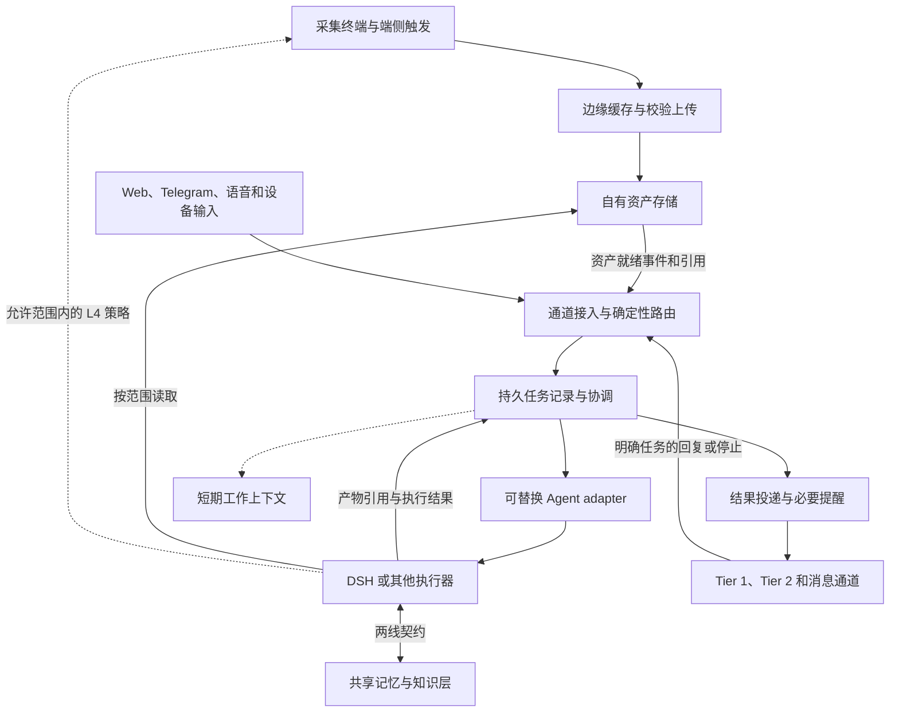

# PAT 整体线蓝图评审与升级建议稿

> 状态：草稿，独立评审与升级建议，待用户裁定；不替代现行执行蓝图
> 维护线：整体线
> 最后更新：2026-11-06
> 摘要：保留数据主权、端侧采集和开放协议主线，补齐持久任务记录、多通道路由、执行交接与恢复；有选择地吸收 OpenBot 和 DeepSeek Super-agent 的设计。
> 评审基线：PAT `aaabe761c192573714e07f556d2e1ab52e9c1806`；本轮核对本地 HEAD 与远端 main 一致。评审对象为 `platform/architecture-v1.md`，不是替换 VPS 节点的选型报告。
> 核验边界：读取项目文档、前轮记忆线评审及两个官方仓库的固定版本文档，并比对 OpenBot 更新；未部署参考项目、未访问 PAT 生产节点、未测试硬件或完整协作链路。

## 结论

**PAT 的整体方向成立，OpenBot 与 DeepSeek Super-agent 也是合适的重点参考。需要升级的是 Agent 协作的执行约定，而不是推翻采集与数据主权架构。**

现行蓝图能解释设备怎样采集、自有数据怎样保留、Agent 怎样替换，但尚不足以回答：用户换一个入口后任务如何延续；多个 Agent 谁对结果负责；旧执行者停没停；重启后哪些动作已经做过；最终成果有没有真实落盘并送达。这些问题不能只靠共享记忆解决。

建议把 Agent 层明确为三个逻辑部分：**通道接入、持久任务协调、可替换执行器**。短期上下文继续保持轻量；任务归属、用户决定、执行记录和交付回执持久保存；共享长期记忆通过两线契约接入。逻辑分工不要求部署成三个服务，更不要求另建一套 Agent 平台。

参考方向没有严重错误，但下列用法会造成方向偏差：

- 把 OpenBot 的完整桌面、账号与团队产品当成 PAT 必须复制的底座；或把它的应用内记忆当成已经满足 PAT 的独立共享记忆要求。
- 把 Super-agent 的研究原型或理念文章，当成现有 DSH 节点已经具备的跨设备、多模态、长期自治能力。
- 用“多个 Agent 都能看见消息”代替写入归属与交接；或用“模型说完成了”代替成果与执行回执。
- 为了追求 Super-agent 式主动性，提前引入后台投机执行、全工具看门狗和自动改规则，超出当前用户任务与运行预算。

**冻结判断：硬件与数据主权的既有原则可以继续保留；当前正文不能直接充当完整协作层的实施基线。** 本稿第三至第五节的责任边界、恢复语义、数据生命周期和最小验收条件写清并经用户裁定后，可以冻结升级后的设计基线。运行能力仍须分别验收，不能把“文档冻结”写成“整个 PAT 已跑通”。

## 一、评审范围与当前事实

本次沿“采集 → 自有存储 → 任务接入 → Agent 执行 → 记忆读写 → 结果送达”检查整体设计。与前轮只评共享记忆及读写接入边界不同，本稿覆盖多通道、多智能体与端云衔接；硬件型号性能、数据交易商业方案和生产安全审计不在本次实测范围内。

| 对象 | 已有依据 | 本次判断与边界 |
|---|---|---|
| 采集与边缘 | [执行蓝图](../architecture-v1.md)的 L0–L4、离线缓冲和自有数据路径 | 保留；补离线、积压、策略过期和停止采集语义，未验证设备性能 |
| 数据主权 | 蓝图的数据层与开放格式原则 | 保留；补生命周期、备份恢复、消费范围和可迁移性，暂不建设定价交易系统 |
| Agent 接入 | 蓝图的 adapter；[节点配置方案 §3.6](../hermes-config-spec.md)的薄桥约束 | 保留桥的职责边界；补任务状态归属和能力验证，历史 Hermes 参数不直接套给 DSH |
| 多通道与多 Agent | [设计采收 B19–B23](../design-harvest.md)，尚未形成统一执行约定 | 本稿重点：身份绑定、任务路由、归属、交接、恢复与投递 |
| 共享长期记忆 | [前轮评审](../../memory/2026-11-05-blueprint-review-report.md)及[证据材料](../../memory/2026-11-05-review-evidence-notes.md) | 承接其问题与建议，不将待裁定评审升级为已接受规则；不替记忆线改稿 |
| 云端节点 | [DSH 验收结论 §5](../dsh-deployment-verdict.md)记录用户已裁定可用 | 这是已有验收记录，不是本轮对当前在线版本、插件和所有入口的复验 |
| 输出与人工介入 | 蓝图的 Tier 1、Tier 2、审批卡片与待定打扰策略 | 保留可换显示面；补关键提醒、任务控制和交付状态 |
| 两线对接 | [契约区](../../contracts/README.md)已立区，四类契约本体尚待定稿 | 本稿只提出最小对接语义；共享变更须由两线按既有流程留痕 |

现状存在文档漂移：整体蓝图仍以 Muse 为当前示例并把云节点列为待定；根规范的阶段摘要仍写 Hermes 待部署；区 README 写 DSH 待验收；但 DSH 验收记录 §5 已记载用户裁定可用。应分开维护“长期架构”“已接受节点决定”“现场运行证据”，不能靠一份旧摘要推断今天的运行状态。

以下用户裁定继续有效：对用户所派任务的渠道发送不新增门禁；GitHub 访问不限 PAT，提交与推送仍以用户明确授权和行为规则落实；不新建凭单式结构性授权机制；Telegram 社区插件按已裁定方式使用。本稿提出的任务记录用于连续性、去重和恢复，不借机重新收紧这些已接受的决定。

## 二、怎样参考 OpenBot 与 DeepSeek Super-agent

本稿的 OpenBot 指 `nightly-labs/openbot`；Super-agent 指 `deepseek-ai/dsh-superagent-prototype`。下述“已有”均指固定版本官方文档记载，不代表本轮运行验证。

### 2.1 值得吸收的部分

| 设计问题 | OpenBot 的参考价值 | Super-agent 的参考价值 | PAT 建议 |
|---|---|---|---|
| 多厂商接入 | 原生 provider 与 ACP 并存，应用会话记录和厂商恢复句柄分开 [O1]、[O2]、[O4] | 执行器通过 Assignment 接入，业务任务不等同于 DSH Session [S2] | PAT 任务 ID 独立于供应商会话；能用标准协议就用，必要原生能力留在 adapter |
| 多通道连续性 | 回复关联、明确收件人等先确定性路由，歧义才交模型；外部消息与执行线程有绑定 [O3] | 新工作评估和已有任务订阅分开；同一话题可承载多个任务 [S2]、[S3] | 先记录绑定，再补语义路由；不要让每条状态消息都绕一次总管模型 |
| 协作与交接 | 子任务、所有权转移、停止、继续、重派；重派等待旧执行停止，旧任务修订不能完成新请求 [O3] | 任务与多次派工分开，执行会话和目录按任务组织 [S2]、[S4] | 一个任务有明确负责人；并行分工落在子任务和独立产物，交接有状态 |
| 状态与恢复 | 应用数据库与工作缓存分开；附件、消息提交和清理有对应记录 [O2] | Engine 单点修改任务状态，事务后执行外部工作，Outbox 保留待发送记录 [S5] | 复用现有持久能力，补最小缺口；初期可单进程、单数据库，不必先上分布式工作流 |
| 上下文与文件 | 截断附续读入口；受管附件有来源、大小和校验信息 [O2]、[O3] | 来源、任务、会话分离，相关内容和新授权分开 [S2]、[S3] | 上下文包有原始引用；附件按引用交接，不复制整段历史与二进制到所有 Agent |
| 人的注意力 | 任务控制与问答卡片独立于普通消息，避免把内部过程全发给人 [O3] | 只在用户能利用结果或必须介入时通知，强调人的注意力成本 [S1]、[S6] | 默认交付结果、必要提问与异常；进度可查，停止始终可达 |

### 2.2 必须纠正或收窄的参考结论

1. **“一个频道永远只有一个负责人”应改成“每个任务有明确负责人”。** 采收 B23 的概括过粗。当前 OpenBot 支持同一请求选多个成员，并分别建立根任务；也支持显式委派与转交。PAT 可以让多人评审同一个问题，但同一份正式成果的写入必须指定归属，不能让“频道唯一负责人”把独立工作全串行化。[O3]
2. **“共同事件流自行解决冲突”不足以执行。** B19 描述的共享可见性有帮助，却不能阻止两个工作者同时推送、发信或覆盖文件。需要任务归属、资源归属与旧派工失效检查；两个 Agent 彼此看见，不等于它们已经达成一致。
3. **“CLI 由应用永久钉版”不宜继续沿用。** B21 是当时的调研快照。当前 OpenBot 文档说明运行时管理器会在启动、每小时及人工检查时查询上游最新版本，锁文件版本是首次安装尚未完成检查时的基线。PAT 仍应采用自己的版本记录和相称回归策略，不能把产品管理下载等同于 PAT 所需的版本冻结。[O4]
4. **不能断言 OpenBot 没有共享记忆或审批。** 当前文档包含频道记忆、外部消息连接记忆，以及 Workspace only、Ask first、Full access 权限模式；频道隔离也不是绝对双向隔离，Agent 记忆仍可进入频道。另一方面，README 的预览警告仍写全权限与不逐次确认，与详细文档存在口径差异。应按具体 provider、构建与模式查实，不能凭单段说明作整个平台的权限保证。[O1]、[O2]、[O3]
5. **“迁移蒸馏包是唯一可行解”没有足够证据。** 采收 C9 支持的是某条具体导入路径，不足以排除原始历史导出和独立来源归档。PAT 可以导入人格、技能与提炼记忆，但必须保留“这只是可获得的迁移子集”的说明，不能用它替换完整来源保存责任。[O1] 与前轮记忆线 R1 一致。
6. **OpenBot 当前代码许可不能按 Apache-2.0 默认处理。** 固定版本使用 PolyForm Noncommercial 1.0.0，README 说明商业用途需另行许可，旧版本至 0.1.11 仍为 Apache-2.0。本次借鉴设计，不搬代码；若将来复用实现或向公开仓导出，须先核对所选版本的许可范围。这不构成停止个人研究的理由。[O5]、[O1]
7. **Super-agent 原型、文章设想、当前 DSH 实例是三个对象。** 官方 README 明言其为研究原型，面向一个 GitHub 仓及可选飞书，公开版不等同于内部实现，文章部分方向尚未实现。B20 的跨设备环境分离和 E15 的全工具 Watchdog 可保留为研究线索，不能据此认定当前节点已经可用。[S1]
8. **Super-agent 的身份与授权语义不能直接搬来。** 原型不建立跨来源身份映射；同一话题的新人工消息可让未被人停止的已结束任务沿用原 Mandate 恢复，恢复前会按当前策略复验；策略变化则不立即撤回运行中任务。这是其代码协作场景的设计取舍，PAT 跨通道控制、借屏确认和端侧策略仍需明确身份、作用对象、时效与撤回边界。[S2]、[S3]

因此建议借 OpenBot 的接入、交接和交互经验，借 Super-agent 的任务领域划分与低打扰原则，保留 PAT 自有数据、协议和两线治理。两套产品都不自动成为 PAT 的总架构权威。

## 三、蓝图的八项实质修订意见

以下优先级针对“能否作为升级后的设计与实施基线”，不是要求本轮立即建设全部能力。

### R1　拆开持久任务记录与会过期的工作上下文——冻结前必改

**依据：** 蓝图第 68–77 行把目标、步骤、决策和审批状态装进任务结束后会过期的工作记忆；配置方案 §3.6 又允许任务状态由工作记忆或 Agent 侧承接，责任仍不唯一。

**问题：** 任务已经在外部产生影响，临时上下文却过期或供应商会话不可用，系统无法可靠判断该续作、补送结果还是停止。换 Agent 后还可能重做已经完成的动作。

**建议：** 在 Agent 层内指定一份 PAT 持久任务记录作为任务归属、修订、执行结果和交付状态的权威。可以先由现有 DSH 持久接口承载，但须说明导出和替换路径；若不满足，再补最小协调组件。不得同时让多个系统都声称自己是任务状态权威。

| 内容 | 权威归属 | 生命周期 |
|---|---|---|
| 原始音视频、图片及其资产清单 | 自有数据层 | 按资产保留、备份和授权清除策略处理 |
| 请求原件、任务归属、修订、用户决定、派工与交付记录 | 持久任务记录；原件也可引用独立来源存储 | 保留到满足恢复、复核与用户清除要求，不随工作缓存 TTL 一起消失 |
| 当前步骤提示、检索片段、推理中间摘要 | 工作上下文 | 可限额、压缩、过期；保留必要的原文续读引用 |
| 跨任务经验与知识 | 独立共享记忆及知识层 | 遵守记忆线的来源、确认、争议、过时与撤回规则 |

这四类是责任边界，不强制四套物理存储；任务记录也不需要保存模型的隐藏推理。蓝图“长期记忆各 Agent 自带”应改为允许自带记忆与独立共享记忆并存，后者通过契约接入，不挤入短期 TTL 层。

### R2　把通道、身份、任务、执行会话分开——冻结前必改

**依据：** 蓝图的“thread / workflow ID”尚未解释跨通道续作；输出层只描述 pub/sub。Super-agent 明确区分 Thread 和 Ticket，OpenBot 也有独立执行线程。[S2]、[O3]

**建议：** 每个任务有稳定的 PAT 标识，关联来源平台、会话、消息与当前项目；各 Agent 的 session/run ID 只是该任务某次执行的句柄。一个会话可承载多个任务，一个任务可关联多个会话，不能直接把聊天 ID 当任务 ID。

先用单用户已核实的账号和设备绑定处理跨入口身份，不建立企业级身份系统。明确回复某条任务消息、指定任务或明确收件人的请求优先确定性路由；“继续”同时可能指向多个任务时，才澄清对象。检索到相关历史只提供背景，不能把任务自动切到那个项目，更不能取得新的行动授权。

已有任务的后续消息直达其负责人，长任务使用独立执行会话，避免占住接收新请求和查状态的入口。资产就绪事件只唤醒已授权订阅的任务，不因出现新数据就自动开新工作。

对原本就需要用户确认的动作，保留确认所对应的任务修订、具体对象与操作范围，必要时注明有效期；跨通道回复关联原问题，旧确认不适用于变更后的对象，重复回复不重复执行。这是保存已有决定的含义，不新增逐动作审批或凭单系统。

结构化停止按钮或停止指令直接进入控制路径，不排在长模型队列后面。自然语言里的复杂停止范围仍可解释，但不能只有模型恰好读到它才有停止能力。

### R3　按任务和写入对象安排协作，交接先确认旧执行停止——冻结前必改

**依据：** 蓝图第 75 行仅规定乐观并发与 409 重试。这能发现状态写入冲突，不能阻止状态之外的两个外部动作同时发生。

**建议：** 一个任务的当前派工有明确负责人和修订号；修改同一正式文件、分支或其他写入对象时，只允许一个当前写入者。互不冲突的子任务可并行；评审意见可并行产生，正式合并由负责人完成。任务改目标、重派和停止后，旧派工的迟到结果不能覆盖新修订。

转交时记录已完成、未完成、已产生的外部影响、可复核产物与待决事项；确认旧执行停止，再启动新的写入执行。无法确认时显示“原执行状态未知，待核对”，先保留只读调查能力，不盲目重发写动作。初期用单一协调写入者与版本校验即可；不要让长期数据库锁跨越模型运行，也不必预建分布式租约系统。

任务归属是协作纪律，不是宿主机权限隔离。Agent 若持有可绕过协调器的直接写入工具，不能宣称上述机制已构成不可绕过的强保证；需要用同一文件并发、延迟结果和进程中断用例查实边界。[O3] 明确承认外部副作用不保证恰好一次，PAT 也应如此。

### R4　区分接收、执行、验证、交付，补齐重试与未知结果——冻结前必改

**依据：** 蓝图第 98–110 行规定传输协议和正常流程，没有完整说明重复消息、附件上传未完成、执行后失联与最终答复补发。

**建议：** 保留 MQTT 事件与 HTTP 文件分工。消息确认不能替代业务完成；文件上传先确认可读和完整，再发布可消费的资产引用。输入保留稳定事件 ID、来源与去重记录；任务变更与待投递结果关联保存，通道恢复后补送。首次接收的记录应先可靠保存，再进入模型加工，沿用前轮记忆评审的保全原则。

执行成功、成果通过相称检查、平台接受投递、用户已查看分别记录，不能混称“完成”。没有阅读回执的通道只能证明到平台接受。发送超时、执行响应丢失时，先凭原请求标识、产物与平台回执查询现状；接口支持幂等键才据此安全重试，不支持且结果未知时提示核对，不能因网络重试重复执行用户动作。

幂等与待发送记录是可靠性机制，不要求完整复制 OpenBot 的事件溯源框架。优先查现有 DSH、插件和数据库已经承接了哪些责任，再补缺口。[O2]、[S5]

### R5　保持 adapter 薄，任务协调不能偷偷塞进协议桥——冻结前必改

**依据：** 蓝图第 94 行“私有协议终止于固件”与第 102 行云端 adapter 方向容易被读成不同限制；节点配置方案已有清楚的薄桥边界。

**建议：** 长期原则统一解释为“厂商私有协议终止于相应 adapter，不渗入 PAT 的数据、任务和输出契约”；设备侧 adapter 可在固件，云端 adapter 不必搬到固件。MQTT/HTTP 仍是 PAT 层间骨架；ACP 是可选的 Agent 控制接入，MCP 是工具与记忆访问入口，均不替换骨架。

薄桥负责翻译、鉴权、关联标识与协议错误映射；持久任务协调拥有业务状态。两者可以同进程，但职责不能混写。每个 adapter 按已测构建声明启动、停止、查询、续作、附件与人工提问能力；不支持原地续跑时如实采用重新派工和引用交接，不把“能读历史”称作“能恢复执行”。

迁移时不能要求逐字恢复厂商内部上下文，应该证明任务意图、授权范围、原始引用、已完成动作与产物能被新执行器理解并继续。数据层无须改变；采集 → 数据层仍绕开协议桥，桥或 Agent 故障不影响自主采集。

### R6　共享记忆提供证据和经验，不拥有当前任务的执行权——冻结前必改

**依据：** 前轮记忆线 R1–R5 已指出原文裁剪、批准版本、范围过滤和恢复问题；本轮不能仅增加 Router 就默认这些缺口消失。

**建议：** 接入任务时检索获准范围内的历史，返回来源、版本、有效状态和继续查原文的入口。已检索、已注入与模型实际采纳分别对待；检索失败不能显示为“没有相关内容”。当前任务决定以任务记录和当前用户指令为准，旧记忆不能重新授权提交、发送、恢复已取消任务或扩大采集范围。

任务结果可沉淀为经验候选；进入长期知识的确认按记忆线规则，不能因总管模型说“记住”而自动晋升。模型读取的网页、附件、他人消息和其他 Agent 的输出都保留来源身份，不能被转述成用户指令。未经授权的跨项目内容不通过检索、原文展开或上下文转交漏入新任务。

跨线最小对接在已有四类契约中表达即可：来源与任务关联、文件引用及完整性、范围内读取与明确失败、知识权威及有效状态。任务调度、重派和投递的内部状态留在整体线，不向记忆线复制完整运行时。厚记忆的默认使用继续接受前轮建议的同输入、同 reader、可比预算对照；多 Agent 效果也不能只拿刻意弱化的单 Agent 作比较。

### R7　把数据主权补成可保存、可迁移、可清除、可离线恢复——数据接入前必答

**依据：** 蓝图第 18、57–60、74 行强调自有和只增不改，但缺少保留终点、清除后的恢复处理；边缘层只概括缓冲。两个参考项目都不能替 PAT 完成这一部分。

**建议：** 日常原始记录只追加，纠正与派生内容留来源；用户明确要求清除时，按范围处理原件、派生物与备份恢复，避免已清除内容被重放导入。明确哪些记录必须保留以防重复执行，不能把“只增不改”解释成个人资料永远无法删除。

离线采集有本地停止、容量限制、积压可见和重传校验；存满或采集失败必须能看见，不默认偷偷丢弃。云端 L4 策略有版本、作用范围与有效期，端侧对已过期、越界或被撤回的策略拒绝执行；不能用云端更聪明为理由绕开端侧触发与停止。

同一资产的原件、转写、摘要、缩略图建立来源联系，按任务需要发送相应层级。用外部模型加工仍发生数据外发，文件在自有磁盘并不等于数据从未离开；如当前权限无法强制限制，应说明实际保障是规则还是技术隔离。这个记录要求不恢复已被用户取消的发送审批门。

借来的大屏只呈现该任务、该显示面适合展示的内容；渲染权不等同于控制权或全量资产读取权。敏感详情和确认动作绑定已核实的用户/设备及具体对象。资产定价和未来交易可先保留用途、归属、授权范围的接口位置，不把远期愿景扩展成眼前的市场平台；已导出的第三方副本不能承诺技术上全部召回。

### R8　低打扰、预算和可停止应先于主动自治——首个长期任务前必答

**依据：** 蓝图第 88、147 行仍把打扰策略延后；采收 E14/E15 已涉及后台执行和可动手的 Watchdog。

**建议：** 定义三类输出：可使用的结果、必须用户决定的问题、阻断或失联异常。常规进度保留可查入口，长任务应给初次接收状态与必要检查点；“只发最终答案”不能让错误和需要用户处理的问题也消失。语音/小屏只给摘要与任务标识，大屏承接详情。

先记录任务耗时、模型调用、重试与人工介入；按当前运行条件设置有界并发、重试上限和可检查的成本上限，预算不足时停止新增工作并保留续作状态。沿用已有预付费边界，缺精确计量时明说，不预建计费平台。

看门狗先检查无进展、失败回执、落盘结果与异常积压；模型诊断按需介入。不要默认赋予它在线改提示词、扩权限或重启已取消任务的权力。新主动功能先作只记录候选的观察，再由用户决定是否启用有预算的试做；不能把用户授权的一次任务扩成常驻监听。原型的自动合并提示词也不能覆盖 PAT 的提交、推送与合并授权约定。[S4]

## 四、建议写入蓝图的最小升级形态

下图是逻辑责任划分，不是新增服务清单。第一版允许复用现有节点和单一持久存储。

建议用下列三段替换或补充原蓝图相应章节，作为待裁定文本：

> **任务与上下文。** PAT 任务独立于聊天通道和厂商会话。任务的目标修订、当前负责人、执行记录、用户决定与交付状态持久保存，并能随执行器替换迁移。短期工作上下文只保存任务当前所需的引用、步骤提示和摘要，可以过期；其过期不得删除任务恢复所需的记录。原始资产与跨任务长期记忆分别由数据层和共享记忆线维护。
>
> **协作与路由。** 通过来源消息和明确任务绑定处理续作，只有未绑定或有歧义的新请求才需要语义分派。任务负责人可以显式委派子任务；同一写入对象的当前写入者必须明确。重派先确认旧执行停止，再交接来源、产物、已发生动作与待决事项。结果未知时先查询与核对，不盲目重复执行。订阅和记忆召回只增加上下文，不增加行动授权。
>
> **协议与恢复。** PAT 层间继续使用 MQTT、HTTP 和开放文件格式，厂商私有协议止于 adapter。输入、任务变更、外部动作与投递结果可相互追溯；接收、执行、产物核验、送达与阅读分别报告。失败显露，重复投递可识别，取消和过期决定不因重启而失效。采集数据路径独立于任务协调与 Agent 桥，云端故障不阻塞本地保存。

任务记录只需先承载五组信息，不预建完整工单产品：来源及范围；稳定任务标识与目标修订；负责人及当前执行句柄；关键状态、动作结果及产物引用；回复目标和投递回执。具体字段名称、状态枚举和数据库格式在接入核验后确定，避免平行设计与现有 DSH 重复的账本。

停止与取消应可区分：停止表示暂停继续执行并保留上下文；取消表示终止当前请求，迟到消息不能自动复活它。停止无法撤销已发生的外部动作；这些动作必须在结果记录中说明。这里只统一语义，不要求照搬某个产品的按钮集合。

### 一条完整使用路径

用户在 Web 建立“整理本次会议资料”的任务，手动采集的录音先保存在自有存储，校验完成后任务收到资产引用。DSH 处理获准材料；缺少关键条件时，Telegram 发出带任务关联的简短问题。用户从手机回复，系统根据消息绑定继续原任务，不凭相似措辞新开一份任务。

如需另一厂商 Agent 评审，负责人委派只读评审子任务，提供原始材料入口与草稿版本，正式文稿仍由指定写入者更新。若需要完全换执行器，则先核对原执行停止与已发生动作，再交接。结果文件核验可读后送达用户；网络失败只重试投递，不重新生成并覆盖成果。任务可另行产生经验候选，候选的确认与长期收录遵守记忆线规则。

这条路径同时检验自有数据、多入口续作、多 Agent、产物、记忆和送达。第一次演练可用用户提供的样例文件代替新硬件采集，硬件链路后续独立接入。

## 五、实施顺序与验收建议

这是后续实施建议，不是本轮已获授权的部署计划。U0–U3 是整体线的局部交付顺序，不替代或延后记忆线已裁定的阶段二厚管线里程碑。

| 顺序 | 最小工作 | 完成条件与停止点 |
|---|---|---|
| U0　校准现状与责任 | 核对实际 DSH/插件版本、已有状态和投递能力；把上述责任写进升级蓝图；整理旧摘要与验收记录的指向 | 有一份当前能力清单，逐项区分已验、未验、不支持；不重复造已有功能，不新增采购 |
| U1　两入口、一个 Agent | 用现有 Web + Telegram 和 DSH，跑通样例文件 → 任务 → 提问/回复 → 实际成果 → 送达；补必要持久记录与停止能力 | 正常续作、重启、重复消息、未知结果和投递失败用例通过；无需等待长期记忆全量建成 |
| U2　第二个执行器与记忆接入 | 接第二厂商 Agent；完成只读委派、单写入者交接、原始材料续读与记忆接口；验证 provider 替换 | 同一任务和数据换执行器可继续；记忆读写证据按记忆线自身阶段验收；不能以更换同一客户端的模型名代替跨厂商交接 |
| U3　设备与有限主动性 | 接一条真实端侧采集/离线重传/开放显示链路；确有收益时再试有预算的主动候选与后台工作 | 端侧停止、积压、失联和策略过期可见；自动化比人工触发有可度量收益且不损害底线，再决定扩展 |

对人的承诺按可用入口逐个扩大。U1 完成不代表所有消息平台支持，U2 完成不代表任意厂商都能原地续跑，U3 完成不代表全场景无人值守。

### 最小验收用例

以下用例本轮均未执行。实施时保留输入、版本、实际输出与核验记录，不接受单纯由模型生成的 PASS。

| 场景 | 必须看见的结果 |
|---|---|
| 1. Web 发起、Telegram 回复，同一通道又开另一任务 | 正确关联任务与项目；歧义明确显露；无跨任务串写 |
| 2. 同一事件重复到达，附件晚于消息上传完成 | 不重复派活；未就绪文件不会被宣称可读；校验完成后能继续 |
| 3. 文件已生成后节点重启、最终消息尚未送达 | 找到真实文件和原任务；补交结果，不重复改写成果 |
| 4. 外部动作可能成功，但响应丢失 | 通过回执或现场事实核对；无法确定时呈现未知，不自动重复动作 |
| 5. 旧 Agent 仍运行时请求换人，随后旧结果迟到 | 新写入不会提前启动；旧结果不能覆盖新修订；无法确认停止时如实等待核对 |
| 6. 两个 Agent 同时处理同一正式文件 | 一个写入者或隔离产物后由负责人合并；不靠最后写入覆盖 |
| 7. 停止/取消后断网再重连；旧确认卡片又被点击 | 不自动复活被取消工作；只对原对象及有效修订响应；已产生动作可追溯 |
| 8. 超长原文、摘要错误、检索故障或被撤回的知识 | 能续读实际来源；标明缺失和有效状态；故障不伪装无记忆；旧知识不变成新授权 |
| 9. 另一项目文件、他人引用和 Agent 转述进入任务 | 读取范围有效；来源身份保留；材料文本不能改变用户的任务边界 |
| 10. 新执行器接手、原 provider 会话不可用 | 不依赖原会话也能读取任务、材料、产物与动作记录；能力不足明确降级 |
| 11. 采集端离线、存储接近上限、L4 策略过期、借屏断开 | 本地保存/停止与异常提示符合约定；积压可恢复；旧策略和借屏不会扩大数据访问 |
| 12. 从备份恢复，另有已授权清除的资料 | 恢复必要原件和任务记录；派生物、批准版本和引用关系可核对；已清除内容不被无声重新导入 |

价值验证另行记录：可用成果率、跨入口续作成功率、误路由/重复执行次数、人工介入与通知数量、耗时和实际成本。比较多 Agent、语义 Router 或厚记忆的增量时，使用同一任务输入、相同权限和可比资源预算；结果允许为“没有收益”或“证据不足”。不把自动任务数、Agent 数量或消息量增长当成效果提升。

## 六、建议的文件修订范围与冻结条件

用户采纳后，建议按主责位置完成以下修订；本轮只生成这份报告及索引入口。

| 文件/区域 | 建议改动 |
|---|---|
| [整体执行蓝图](../architecture-v1.md) | 调整 Agent 层和工作记忆层，加入任务记录、路由交接、恢复、数据生命周期与阶段验收；保留原采集原则、硬件探索节奏和开放协议 |
| [蓝图可视化](../architecture-viz.html) | 在正文修订确认后同步图示，实际检查浏览器呈现、交互和窄屏；本轮未改图 |
| [区 README](../README.md)、根阶段摘要与节点文档 | 指向已接受的 DSH 裁定；区分历史记录和当前现场核验，不用新报告覆盖历史验收 |
| [设计采收册](../design-harvest.md) | 对 B19、B21、B23、C9 增补本轮版本与边界；B20、E14、E15 保持待验证方向，不直接升为当前需求 |
| [共享契约区](../../contracts/README.md) | 在实际对接前定稿来源、文件、读取与权威的最小语义，并按契约变更记录规则协调两线 |
| 记忆线 | 由该线处理前轮修订建议，整体线只引用经确认的契约和结果，不代改其蓝图 |

冻结升级版设计至少应回答五件事：任务状态谁负责；跨入口如何认人和认任务；交接/停止/未知结果怎么处理；资产与记忆怎样保全、读取和清除；哪些入口与能力在哪一阶段取得什么运行证据。具体产品实现、规模化部署和主动自治无需全部先定。

**推荐选择：保留当前 DSH 节点，以 U1 的真实两入口任务作为第一份升级交付；OpenBot 和 Super-agent 作为设计与实现核验参照。** 只有现有节点无法承接已明确的最小责任，且替换收益有证据时，再讨论引入新底座或自研运行时。这样既能推进整体 PAT，也不让硬件线与记忆线互相等待一个尚未验证的大平台。

## 七、固定来源与证据边界

外部来源在 2026-11-05 首轮读取，2026-11-06 继续核验。OpenBot main 从首轮 `1729761d…` 前进到下列提交，已刷新相关文档并检查差异；Super-agent 提交不变。固定链接用于复核本稿判断，不表示未来版本仍相同。

| 编号 | 官方来源 | 本稿使用范围 |
|---|---|---|
| O1 | [OpenBot README][O1] | 项目定位、provider 接入、迁移入口、预览警告与许可说明 |
| O2 | [OpenBot 状态归属与仓库结构][O2] | 数据库、缓存、附件提交、厂商状态、权限模式及共享数据边界 |
| O3 | [OpenBot 频道与消息架构][O3] | 多任务路由、委派/转交、修订、停止恢复、记忆范围与投递 |
| O4 | [OpenBot provider 架构][O4] | 原生/ACP 接入、上下文与 provider 运行时更新策略 |
| O5 | [OpenBot LICENSE][O5] | 当前许可原文；未作完整法律审查 |
| S1 | [Super-agent README][S1] | 研究原型定位、单仓/飞书范围，与内部版及文章的区别 |
| S2 | [Super-agent 领域模型][S2] | Thread、Ticket、Assignment、Subscription 和来源身份的边界 |
| S3 | [Super-agent 授权设计][S3] | 上下文直通、权限来源、策略变化与任务恢复条件 |
| S4 | [Super-agent 执行设计][S4] | 独立执行会话、工作目录、停止与完成语义、提示词控制的自动合并 |
| S5 | [Super-agent 实现架构][S5] | 单一状态写入者、事务与外部执行、待发送记录 |
| S6 | [Super-agent 设计原则][S6] | 人的注意力与结果导向，作为设计原则而非 PAT 性能证据 |

整体线采收中引用的《Super-agent 设计探索》提供了重要研究线索，但原文章页面本轮未能完整读取；关于云端循环、自有设备执行端、投机执行和全工具 Watchdog 的表述，在本稿中按历史采收与待验证方向处理，不宣称已由公开原型实现。前轮 LLM Wiki 相关材料沿用入仓的通用治理摘要与证据链，未复制私人实例内容。

[O1]: https://github.com/nightly-labs/openbot/blob/3ecbe933d6628022f2119aa7b88f2450b9870329/README.md
[O2]: https://github.com/nightly-labs/openbot/blob/3ecbe933d6628022f2119aa7b88f2450b9870329/docs/architecture/structure.md
[O3]: https://github.com/nightly-labs/openbot/blob/3ecbe933d6628022f2119aa7b88f2450b9870329/docs/architecture/channels-and-messaging.md
[O4]: https://github.com/nightly-labs/openbot/blob/3ecbe933d6628022f2119aa7b88f2450b9870329/docs/architecture/providers.md
[O5]: https://github.com/nightly-labs/openbot/blob/3ecbe933d6628022f2119aa7b88f2450b9870329/LICENSE
[S1]: https://github.com/deepseek-ai/dsh-superagent-prototype/blob/8c32a9dc5d72c033816c6a8110b37f40cf94fba4/README.md
[S2]: https://github.com/deepseek-ai/dsh-superagent-prototype/blob/8c32a9dc5d72c033816c6a8110b37f40cf94fba4/docs/001-domain.md
[S3]: https://github.com/deepseek-ai/dsh-superagent-prototype/blob/8c32a9dc5d72c033816c6a8110b37f40cf94fba4/docs/002-authorization.md
[S4]: https://github.com/deepseek-ai/dsh-superagent-prototype/blob/8c32a9dc5d72c033816c6a8110b37f40cf94fba4/docs/003-execution.md
[S5]: https://github.com/deepseek-ai/dsh-superagent-prototype/blob/8c32a9dc5d72c033816c6a8110b37f40cf94fba4/docs/007-architecture.md
[S6]: https://github.com/deepseek-ai/dsh-superagent-prototype/blob/8c32a9dc5d72c033816c6a8110b37f40cf94fba4/docs/000-philosophy.md
